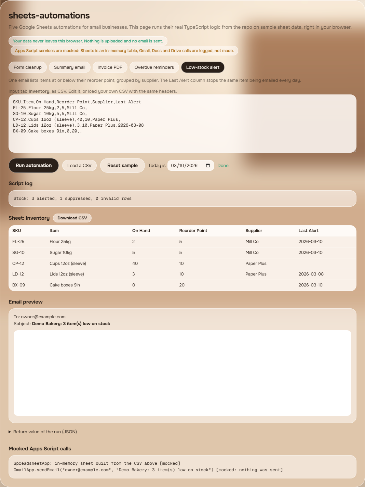
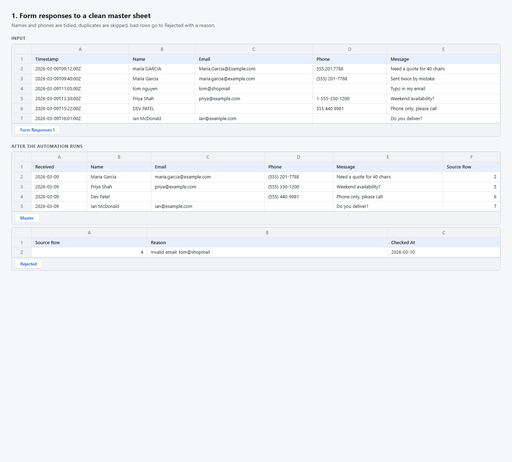
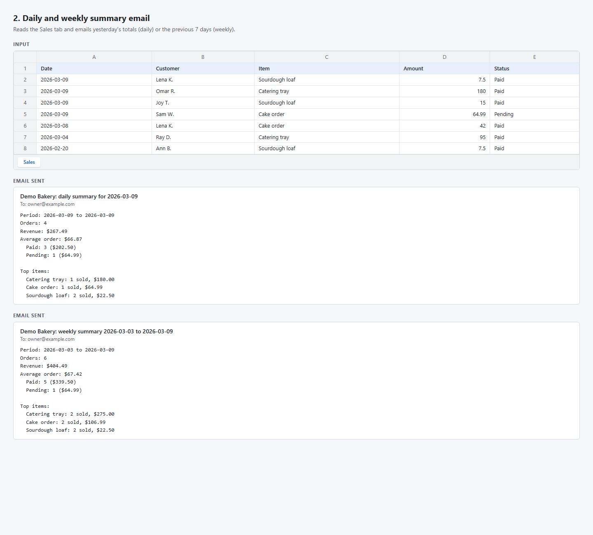
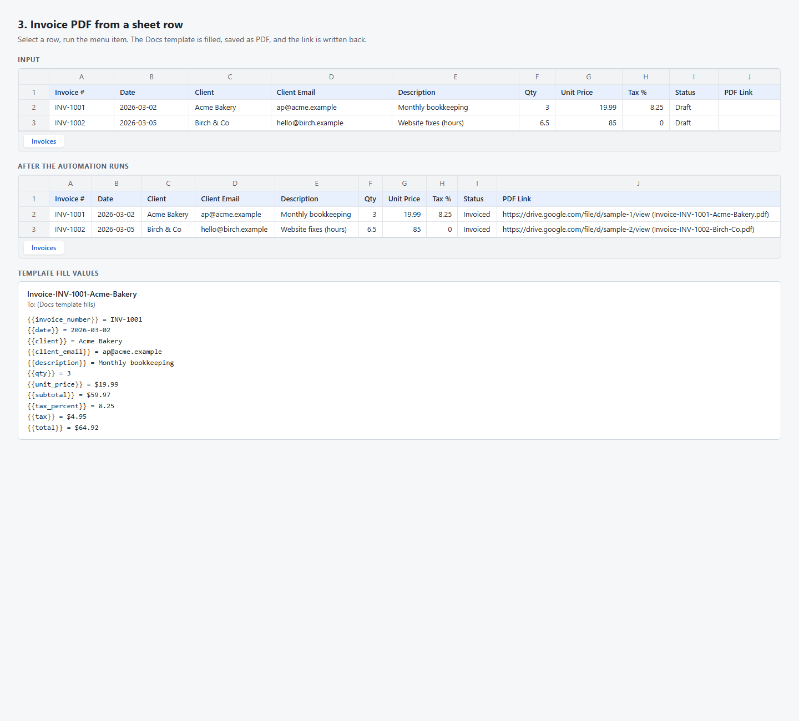
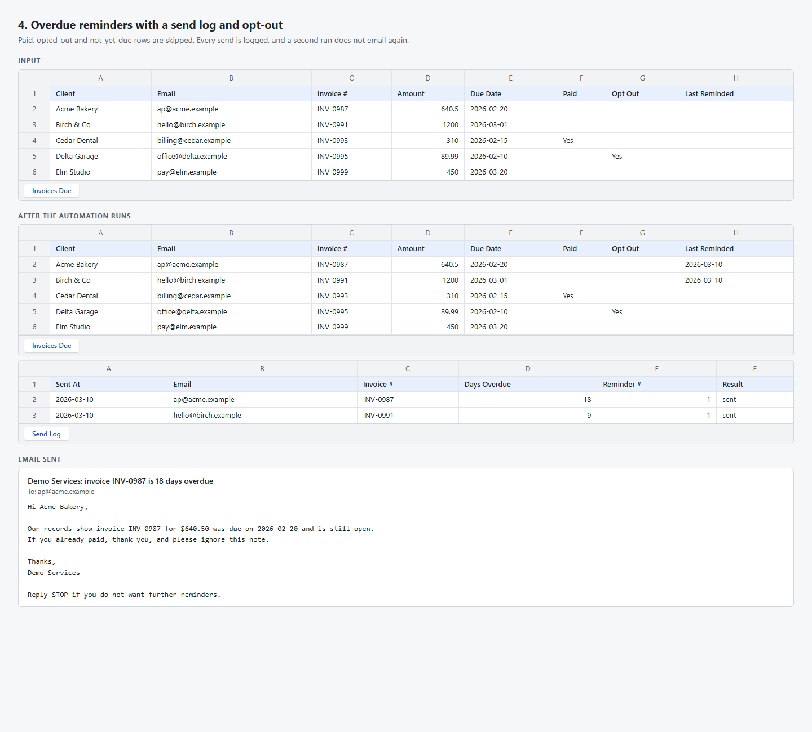
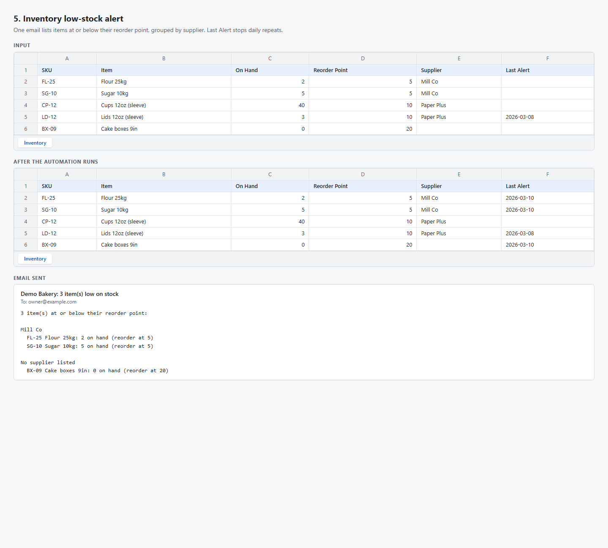

# sheets-automations

[](https://github.com/chasebuilds/sheets-automations/actions/workflows/ci.yml)

**[Live demo: try it in your browser](https://chasebuilds.github.io/sheets-automations/)**. Run the five automations on sample sheet data, or paste your own CSV. The real TypeScript logic runs in the page; Apps Script services (Sheets, Gmail, Docs, Drive) are mocked and labelled, so nothing is sent.

[](https://chasebuilds.github.io/sheets-automations/)

Five Google Apps Script automations that small businesses ask for, written in TypeScript and deployed with clasp. The business rules live in plain functions with no Apps Script dependency, so they are unit-tested in Node with fakes for `SpreadsheetApp`, `GmailApp` and the Docs/Drive calls.

| # | Automation | What it does |
|---|-----------|--------------|
| 1 | Form cleanup | Moves new Google Form rows into a `Master` sheet: trims names, formats US phones, lowercases emails, skips duplicates, sends bad rows to `Rejected` with a reason |
| 2 | Summary email | Emails yesterday's totals (daily) or the previous 7 days (weekly) from a `Sales` tab: orders, revenue, average, status split, top 3 items |
| 3 | Invoice PDF | Select a row, click a menu item. Fills a Google Docs template, saves a PDF, writes the link and `Invoiced` status back to the row |
| 4 | Overdue reminders | Emails overdue, unpaid invoices. Respects an opt-out column, spaces reminders out, stops after a limit, caps each run, keeps a send log |
| 5 | Low-stock alert | One email per run listing items at or below their reorder point, grouped by supplier. A `Last Alert` column stops daily repeats |

## What it looks like

Screenshots are the real automation code run against the sample data in [`samples/`](samples/). They show the sheet layout each automation expects, then the sheet and email after it runs.

| | |
|---|---|
|  |  |
|  |  |
|  | |

## Sample sheets

[`samples/sample-workbook.xlsx`](samples/sample-workbook.xlsx) has one tab per input sheet with the exact headers each script needs. Matching CSVs are in the same folder. Import the workbook into Google Sheets (File, Import) and you can try every automation. Header names are matched without regard to case or surrounding spaces. Column order does not matter.

| Tab | Required columns |
|-----|------------------|
| `Form Responses 1` | Timestamp, Name, Email, Phone, Message |
| `Sales` | Date, Item, Amount, Status (Customer is optional) |
| `Invoices` | Invoice #, Date, Client, Description, Qty, Unit Price, Tax %, Status, PDF Link (Client Email optional) |
| `Invoices Due` | Client, Email, Invoice #, Amount, Due Date, Paid, Opt Out, Last Reminded |
| `Inventory` | SKU, Item, On Hand, Reorder Point, Supplier, Last Alert |

`Master`, `Rejected` and `Send Log` are created on first run.

## Setup

You need Node 20 or newer and a Google account that owns the sheet.

1. Clone this repo and run `npm install`, then `npm run build`. This writes `dist/Code.js` and `dist/appsscript.json`.
2. Create or open the Google Sheet. Add the tabs above (or import the sample workbook).
3. In the sheet, choose Extensions, Apps Script. Note the Script ID under Project Settings.
4. Install clasp (`npm install -g @google/clasp`), run `clasp login`, then copy `.clasp.json.example` to `.clasp.json` and paste the Script ID.
5. Run `clasp push`. Reload the sheet. An **Automations** menu appears.
6. In Project Settings, Script Properties, add the ones you need:

   | Property | Used by | Default |
   |----------|---------|---------|
   | `BUSINESS_NAME` | all emails | `My Business` |
   | `NOTIFY_EMAIL` | summary, stock alert | the script owner |
   | `INVOICE_TEMPLATE_ID` | invoices | none, required |
   | `TZ_OFFSET_MINUTES` | all date logic | `0` (UTC) |
   | `REMINDER_MIN_DAYS` | reminders | `7` |
   | `REMINDER_MAX` | reminders | `3` |
   | `REMINDER_MAX_PER_RUN` | reminders | `50` |
   | `STOCK_REPEAT_DAYS` | stock alert | `7` |

7. Run `installTriggers` once from the editor and approve the permissions. It sets: form cleanup hourly, summary daily at 7, stock check daily at 8, reminders daily at 9. Edit that function to change times.

### Invoice template

Make a Google Doc with these placeholders anywhere in the text, then put its ID (the long string in its URL) in `INVOICE_TEMPLATE_ID`:

`{{invoice_number}} {{date}} {{client}} {{client_email}} {{description}} {{qty}} {{unit_price}} {{subtotal}} {{tax_percent}} {{tax}} {{total}}`

### Try reminders safely

Use **Preview overdue reminders (no email)** first. It shows how many would be sent and skipped and writes nothing.

## How it is built

```
src/core/       pure functions: parsing, dedupe, totals, who gets a reminder
src/services/   one function per automation, takes an Env (sheets, mail, docs, props, clock)
src/gas/main.ts the only file that touches Apps Script globals; builds the Env, adds the menu and triggers
tests/          Vitest, with in-memory fakes for a spreadsheet, Gmail, Docs/Drive and script properties
scripts/build.mjs  bundles main.ts into dist/Code.js with esbuild and adds top-level function stubs
```

Design choices:

- **Money is integer cents** so `19.99 x 3` never becomes `59.970000000000006`.
- **"Today" is injected**, so date logic is tested without touching the real clock.
- **Safe to re-run.** Form cleanup remembers the last row it handled and dedupes against `Master`. Reminders read the send log. Stock alerts stamp `Last Alert` only after the email goes out, so a failed send retries on the next run.
- **Failed sends are logged**, do not count toward the reminder limit, and do not stop the rest of the run.

## Development

```
npm run typecheck   # tsc --noEmit, strict
npm run lint        # eslint, typescript-eslint strict-type-checked
npm test            # vitest with coverage
npm run build       # dist/Code.js
npm run samples     # regenerate samples/ (screenshots are rendered from the same run)
```

The suite has 61 tests. Coverage on `src/core` and `src/services` is 99.6% of statements and 92.5% of branches. `src/gas/main.ts` is the thin glue layer and is not covered by unit tests.

## Limitations

See [LIMITATIONS.md](LIMITATIONS.md). The main one: this repo was never deployed to a live Google account, so `src/gas/main.ts` has been type-checked and bundled but not run against real Google services.

## License

MIT, Chase Builds.
